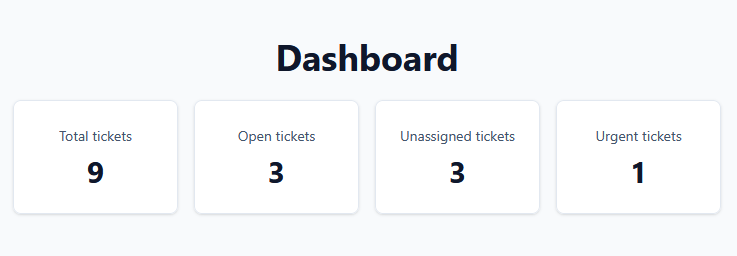
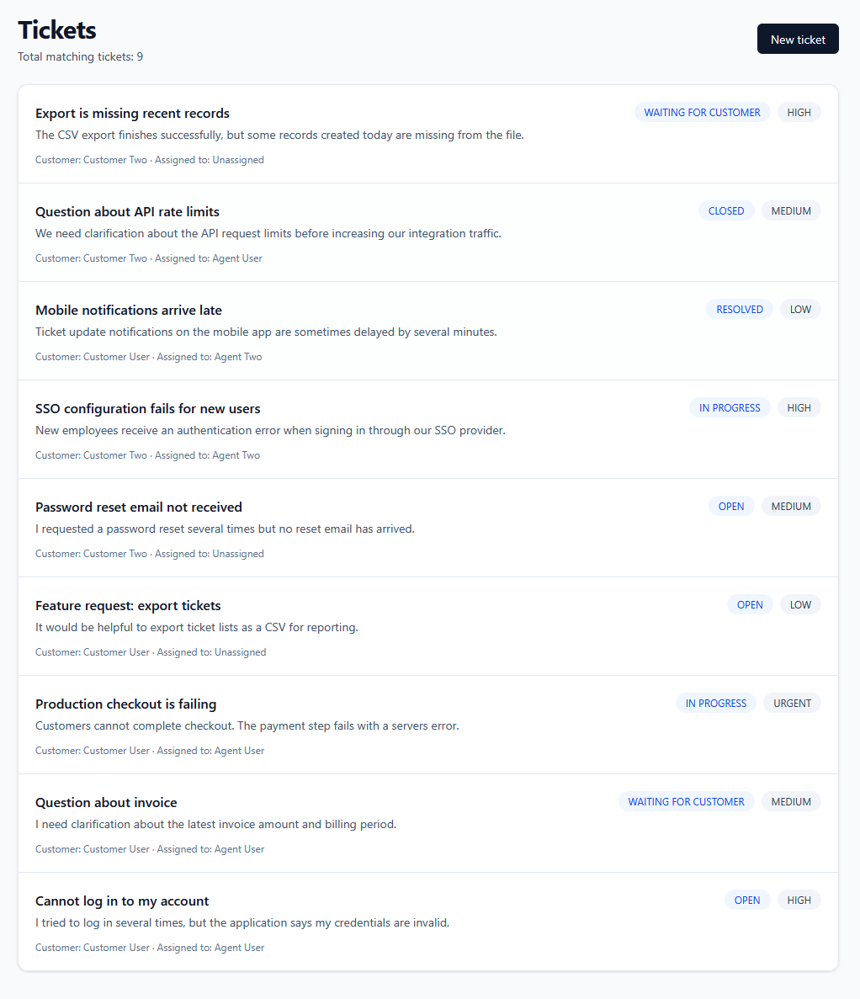
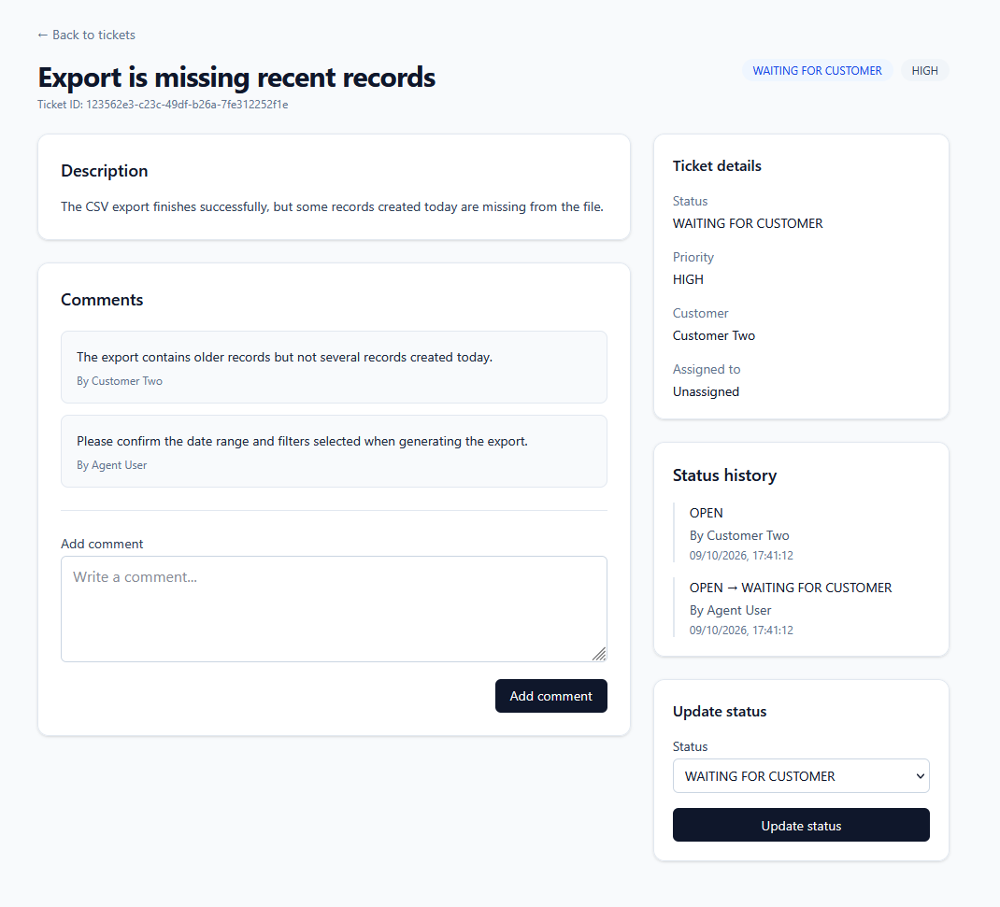
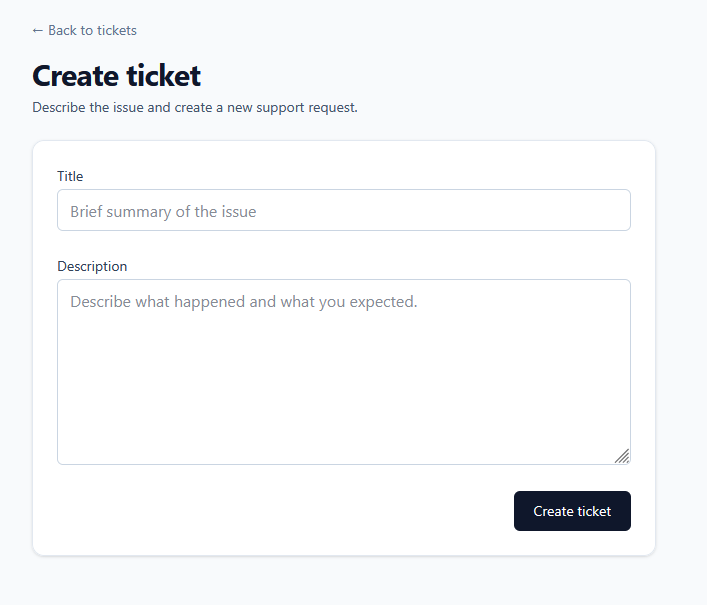

# SupportFlow

SupportFlow is a full-stack helpdesk / ticketing application built as a portfolio project to demonstrate production-oriented TypeScript development across a React frontend and NestJS backend.

> **Status:** In progress, but fully usable for the implemented core workflow.
> Authentication, role-based access control, ticket management, comments, dashboard statistics, backend tests, and initial frontend tests are implemented. Playwright E2E coverage and CI are planned next.

## Features

- JWT authentication
- Role-based access control
- Ticket creation and management
- Role-scoped ticket visibility
- Ticket status workflow
- Ticket assignment rules
- Ticket comments
- Ticket status history
- Dashboard statistics
- Search, filtering, pagination, and sorting
- Swagger / OpenAPI documentation
- Seeded demo accounts
- Backend unit tests
- Frontend component tests
- Dockerized PostgreSQL development environment

## Roles and Permissions

### Admin

- View and manage all tickets
- Assign tickets
- Update ticket priority and status
- Delete tickets

### Agent

- View assigned and unassigned tickets
- Assign an unassigned ticket to themselves
- Update ticket priority and status
- Comment on accessible tickets

### Customer

- Create tickets
- View only their own tickets
- Comment on their own tickets
- Cannot assign tickets
- Cannot change ticket priority or status

Customer-created tickets default to `MEDIUM` priority.

## Tech Stack

### Frontend

- React
- TypeScript
- Vite
- Tailwind CSS
- React Router
- TanStack Query
- React Hook Form
- Zod
- Vitest
- React Testing Library

### Backend

- NestJS
- TypeScript
- PostgreSQL
- Prisma
- JWT
- bcrypt
- Swagger / OpenAPI
- Jest

### Tooling

- Docker Compose
- npm
- Git
- GitHub

## Architecture

```text
React / Vite
     |
     | HTTP + JWT
     v
NestJS REST API
     |
     | Prisma
     v
PostgreSQL
```

## Screenshots

### Dashboard



### Ticket List



### Ticket Details



### Create Ticket



## Demo Accounts

The seed data includes multiple users so role-based ticket visibility can be demonstrated clearly.

| Role       | Email                 | Password    |
| ---------- | --------------------- | ----------- |
| Admin      | admin@example.com     | admin123    |
| Agent      | agent@example.com     | agent123    |
| Agent 2    | agent2@example.com    | agent123    |
| Customer   | customer@example.com  | customer123 |
| Customer 2 | customer2@example.com | customer123 |

The secondary agent and customer accounts make it possible to verify that users see different ticket sets depending on their role and ownership.

## Local Development

For a full step-by-step installation guide, see [SETUP.md](SETUP.md).

### Prerequisites

- Node.js
- npm
- Docker Desktop

### 1. Configure environment variables

Use `.env.example` as the template for your local environment configuration.

Do not commit real secrets or local `.env` files.

### 2. Start PostgreSQL

From the project root:

```powershell
docker compose up -d
```

### 3. Start the backend

```powershell
cd backend
npm install
npx prisma migrate dev
npx prisma db seed
npm run start:dev
```

The backend runs at:

```text
http://localhost:3000
```

Swagger API documentation:

```text
http://localhost:3000/api
```

### 4. Start the frontend

In another terminal:

```powershell
cd frontend
npm install
npm run dev
```

The frontend runs at:

```text
http://localhost:5173
```

## Main API Endpoints

| Method | Endpoint                      | Description                          |
| ------ | ----------------------------- | ------------------------------------ |
| POST   | `/auth/login`                 | Authenticate a user                  |
| GET    | `/auth/me`                    | Get the authenticated user           |
| GET    | `/tickets`                    | Get role-scoped tickets              |
| GET    | `/tickets/:id`                | Get ticket details                   |
| POST   | `/tickets`                    | Create a ticket                      |
| PATCH  | `/tickets/:id`                | Update ticket fields                 |
| PATCH  | `/tickets/:id/status`         | Update ticket status                 |
| DELETE | `/tickets/:id`                | Delete a ticket as Admin             |
| GET    | `/tickets/:ticketId/comments` | List ticket comments                 |
| POST   | `/tickets/:ticketId/comments` | Add a ticket comment                 |
| GET    | `/dashboard/summary`          | Get role-scoped dashboard statistics |

## Testing

### Backend

```powershell
cd backend
npm test
npm run build
npm run lint
```

Current backend test coverage includes:

- ticket visibility rules
- ticket status and assignment business rules
- comment access control
- dashboard visibility and aggregation

### Frontend

```powershell
cd frontend
npm test
npm run build
npm run lint
```

Current frontend tests cover:

- login validation
- successful authentication flow
- protected route behavior
- ticket query rendering
- frontend test environment setup

## Access Control

Authorization is enforced on the backend rather than relying on frontend visibility alone.

Examples:

- Customers can access only their own tickets.
- Customers cannot change ticket status, priority, or assignment.
- Agents can access tickets assigned to them and unassigned tickets.
- Agents can assign an unassigned ticket to themselves.
- Only Admins can delete tickets.
- Comment access follows the same ticket visibility rules.
- Dashboard statistics reuse the same role-scoped visibility logic.

## Seed Data

The development seed includes:

- 1 Admin
- 2 Agents
- 2 Customers
- tickets across all major statuses
- multiple priority levels
- assigned and unassigned tickets
- tickets owned by different customers
- comments from customers and agents
- ticket status history

This makes the role-based access model visible when switching between demo accounts.

## Current Status

### Implemented

- Backend architecture and database model
- PostgreSQL / Prisma integration
- Seed data
- JWT authentication
- Role-based access control
- Ticket API
- Ticket comments
- Ticket status history
- Dashboard summary API
- React authentication flow
- Protected routes
- Dashboard UI
- Ticket list
- Ticket creation
- Ticket details
- Comment creation
- Status updates
- Backend unit tests
- Initial frontend component tests
- Initial UI polish

### Next

- Complete remaining frontend tests
- Add Playwright end-to-end tests
- Add GitHub Actions CI
- Add final screenshots and documentation polish

## Scope

SupportFlow intentionally focuses on the core helpdesk workflow.

Currently out of scope:

- realtime chat
- email delivery
- payments
- file uploads
- multi-tenant billing
- Redis
- Kubernetes
- internationalization
